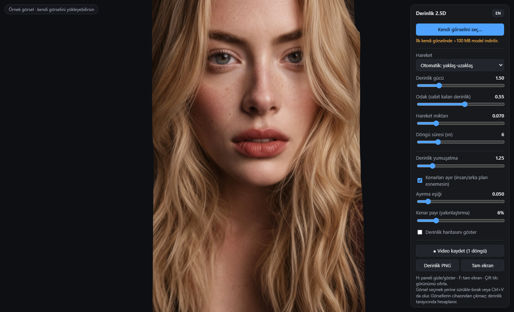

# Depth 2.5D

Turn a single image into a moving 2.5D / 3D view, right in your browser.

**Live:** https://erenciracioglu-dotcom.github.io/depth-25d/

- Depth is estimated locally with **Depth Anything V2 Small** (ONNX, via transformers.js, WebGPU or WASM). Your images never leave your device.
- The image becomes a depth-displaced mesh; edges between subject and background are split and the gaps are filled by a blurred back layer, so people don't stretch into the background.
- Motions: look with mouse/finger, free rotate, circle, horizontal/vertical sway and **dolly in-out** (default).
- Record one seamless loop as MP4/WebM, or download the depth map as PNG.

**Data usage:** the page opens with a sample image whose depth map is precomputed (~1 MB). The ~100 MB model (plus ~20 MB runtime) is downloaded only when you process your own image, once; after that it comes from the browser cache. A warning dialog explains this before anything can be used — on mobile data, prefer Wi-Fi.

The sample portrait is AI-generated.

---

## Türkçe

Tek bir görseli tarayıcıda hareketli 2.5D / 3B görünüme çevirir.

- Derinlik, **Depth Anything V2 Small** ile tarayıcıda hesaplanır; görsellerin cihazından çıkmaz.
- Görsel derinliğe göre bükülen bir ağa dönüşür; kişi ile arka plan arasındaki kenarlar ayrılır ve açılan boşluk bulanık bir arka katmanla dolar.
- Hareketler: fare/parmakla bakış, serbest döndürme, daire, yatay/dikey salınım ve **yaklaş-uzaklaş** (varsayılan).
- Tek döngülük kesintisiz video (MP4/WebM) kaydı, derinlik haritasını PNG indirme.

**Veri kullanımı:** Sayfa, derinliği önceden hesaplanmış bir örnek görselle açılır (~1 MB). ~100 MB'lık model (artı ~20 MB kütüphane) yalnızca kendi görselini işlediğinde bir kez indirilir, sonra tarayıcı önbelleğinden gelir. Bunu anlatan uyarı onaylanmadan sayfa kullanılamaz; mobil veride Wi-Fi tercih et.

Örnek portre yapay zekâ ile üretilmiştir.

License: MIT
